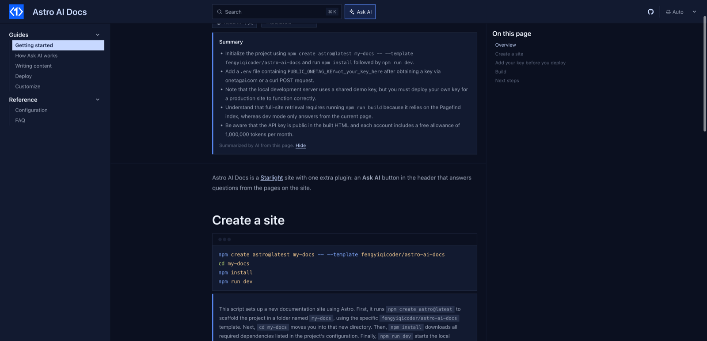

# starlight-onetag-summary

A **Summarize this page** button under the title of long [Starlight](https://starlight.astro.build) docs pages. One click gives readers the key points in 3 to 5 bullets, so they know at a glance whether the page answers their question.



- Shown only on pages longer than 1,500 characters (`minChars`).
- Generated on click by default, so it costs nothing until a reader asks; set `auto: true` to generate it on load.
- Cached in the reader's browser until the page changes.

Live demo: the [Astro AI Docs](https://fengyiqicoder.github.io/astro-ai-docs/) template runs every starlight-onetag plugin.

## Install

```bash
npm install starlight-onetag
```

This plugin ships inside the [`starlight-onetag`](https://www.npmjs.com/package/starlight-onetag) package (0.2.0 and later) as `starlight-onetag/summary`. This repository holds its source and docs.

```js
// astro.config.mjs
import { defineConfig } from "astro/config";
import starlight from "@astrojs/starlight";
import starlightOnetagSummary from "starlight-onetag/summary";

export default defineConfig({
  integrations: [
    starlight({
      title: "My docs",
      plugins: [starlightOnetagSummary()],
    }),
  ],
});
```

## Before you deploy: get a free key

On localhost it works without a key, on a shared demo key. A deployed site needs its own: pass it as `starlightOnetagSummary({ key: "ot_..." })` or set `PUBLIC_ONETAG_KEY` in `.env`. Without one, readers see a line saying AI is not set up, and the build prints a warning.

Fill in your email at [onetagai.com](https://onetagai.com/?ref=starlight-onetag-summary), or run this; the key arrives in that inbox (one key per email, 1,000,000 free tokens a month):

```bash
curl -X POST https://onetagai.com/api/signup -H "Content-Type: application/json" -d '{"email":"you@example.com"}'
```

The key is designed to be public, like an analytics ID: it ends up in the built HTML and can only spend that account's allowance. One key works for every starlight-onetag plugin on the site.

## Options

| Option | Default | What it does |
| --- | --- | --- |
| `key` | `""` (or `PUBLIC_ONETAG_KEY`) | The OneTag AI key. |
| `label` | `"Summarize this page"` | Button text. |
| `minChars` | `1500` | Shortest page that gets the button. |
| `auto` | `false` | Generate the summary as soon as the page loads. |
| `cache` | `true` | Keep summaries in the reader's browser. |
| `lang` | page language | Language of the summaries. |
| `rules` | see `index.js` | Instructions given to the model. |
| `maxTokens` | `400` | Answer length cap. |
| `site` | `https://onetagai.com` | Where the API lives, for self-hosted deployments. |

## How it works

1. The text of the docs content (up to 28,000 characters) goes to OneTag AI from the browser through the [`onetagai`](https://www.npmjs.com/package/onetagai) package.
2. The bullets stream into a panel under the title.

The plugin adds no component overrides, so it works next to any other Starlight plugin or custom component. The AI code is a separate chunk loaded the first time a reader uses the feature; page speed stays where it was. Nothing is stored on a server: OneTag AI keeps token counts and timestamps, not page text or questions.

## More AI for Starlight

- [starlight-onetag](https://github.com/fengyiqicoder/starlight-onetag): Ask AI dialog next to the search box, answered from your pages
- [starlight-onetag-search](https://github.com/fengyiqicoder/starlight-onetag-search): AI answer inside the search dialog, above the Pagefind results
- [starlight-onetag-translate](https://github.com/fengyiqicoder/starlight-onetag-translate): "Read in <your language>" button: AI translation of the page for the reader
- [starlight-onetag-explain](https://github.com/fengyiqicoder/starlight-onetag-explain): "Explain this code" under every code block
- [starlight-onetag-selection](https://github.com/fengyiqicoder/starlight-onetag-selection): select any text, click Ask AI, get it explained in context

## License

MIT. Powered by [OneTag AI](https://onetagai.com/?ref=starlight-onetag-summary).
